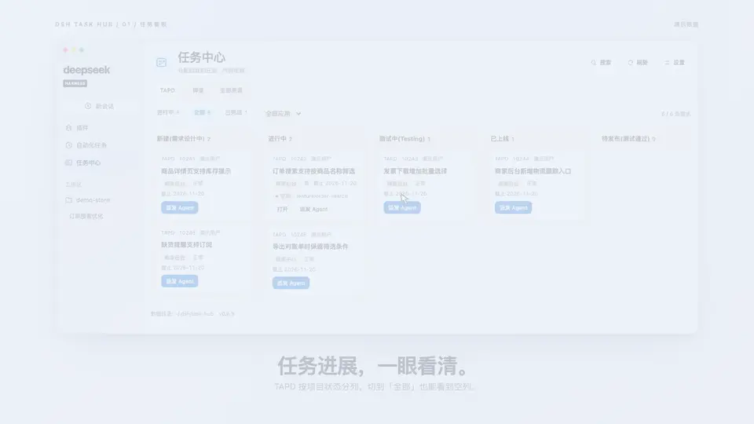

# dsh-task-hub

[简体中文](README.md) · **English**

A task hub for DSH: reads the requirements and tasks assigned to you from **TAPD / ZenTao**, then lets you pick a workspace, type a branch name, and dispatch the selected task to an agent.

Use the TAPD, ZenTao, and **All sources** tabs. Active ZenTao requirements are grouped by development stage. The **All** filter shows empty columns for TAPD project statuses and for the ZenTao stages or statuses of the selected scope. Use **Search** in the top right to find tasks by ID, parent ID, or title. The panel refreshes tracker data every 90 seconds while visible.

## 33-second demo

[](deliverables/dsh-task-hub-apple-v3.mp4)

[Watch the full video (1080p MP4)](deliverables/dsh-task-hub-apple-v3.mp4) · The demo uses sample tasks.

## Install

```sh
dsh plugin --profile web add github:handsomeboy65/dsh-task-hub
```

Restart `dsh web` afterwards — "Task Hub" appears in the sidebar. On desktop, install it from **Settings → Plugins** inside the app.

Requires DSH 0.2.1 or newer. Once the package is on npm, `dsh plugin --profile web add dsh-task-hub` does the same thing.

## The branch name is typed by hand

The dispatch dialog asks for a **complete branch name** (for example `feature/order-export`). The plugin does not derive `issue_<id>` from the work item and does not append any suffix. The name is validated with `git check-ref-format --branch`; an invalid name fails immediately.

## First-time configuration

Click **Settings** in the top-right corner of the panel, pick a source at the top, then fill in that source's fields.

### TAPD

| Field | Meaning |
| --- | --- |
| Authentication | Token, or API account + password |
| API account / password | TAPD open platform → personal settings → API account. This is not your login password. |
| Assignee | Filters stories by assignee; leave blank to use the TAPD account itself |
| Project ID | The TAPD project's `workspace_id`, comma-separated; "Fetch projects" lets you pick |
| Nick | Used when fetching the project list; may be left blank |

### ZenTao

| Field | Meaning |
| --- | --- |
| ZenTao URL | For example `https://zentao.example.com`; `/api.php/v1` is appended automatically |
| Account / password | Your ZenTao login; the password is written only to DSH credentials |
| Scope | `Product` reads product stories, `Project` reads tasks under the project's executions |
| Product / Project | Select multiple entries from the list or enter comma-separated IDs |

ZenTao exposes no "assigned to me" endpoint, so the plugin logs in for a token first and then filters by the current account locally.

Credentials are written to DSH `credentials` (they can also come from the environment variables `TAPD_API_USER` / `TAPD_API_TOKEN` / `TAPD_API_PASSWORD` / `ZENTAO_PASSWORD`). No secret is ever written into the plugin's data files.

### General

| Field | Meaning |
| --- | --- |
| Default workspace | The DSH workspace preselected when dispatching (e.g. TMS2.0) |
| Base branch | Leave blank to detect `origin/HEAD` |
| Isolated worktree | On by default: creates `.dsh-worktrees/<repo>-<branch>` next to the repository so your current branch is left alone |
| Hide completed | The list shows only open items by default |

## Dispatch flow

1. The panel lists items whose assignee is you, newest first, filterable by Open / Done / All. For TAPD stories the **App** custom field (e.g. `德速TMS2.0客户端`) gets its own column ahead of the ID; multiple apps stack as separate tags, and the column is dropped entirely when the source has no app field.
2. Click **Dispatch agent** on an item.
3. For tasks with a linked session, choose **Continue conversation** or **New conversation**. Continuing opens a linked session in its current workspace and prepares the latest task draft. Existing composer content is preserved. A new conversation reuses the task branch. If the original workspace is on another branch, the plugin uses an existing worktree for the task branch or prepares one. For the first dispatch, select the workspace, enter the branch name, and choose the worktree and base branch.

   Extra instructions are appended after the generated brief (title, description, attachments, screenshots, working agreement) under `## Extra instructions`; they never replace the story text.
4. After confirming the first dispatch, the plugin runs these steps in order.
   - `git worktree add -b <branch>` (or `checkout -b` in place);
   - creates (or reuses) a DSH workspace on the worktree/repository and starts a session;
   - writes the title, source link, parent requirement and associated app (when present), full description, reference assets, working environment (repository, branch, comparison baseline), and execution requirements into the new session's **composer draft**; management fields such as assignee, status, priority, iteration, and dates are omitted. Descriptions are not truncated; missing descriptions prompt the agent to read reference assets and clarify the goal;
   - TAPD items bring their attachments (including parent/root stories) and description screenshots; ZenTao fetches item details, inline ZenTao images, and attachments. Those attachments are staged as draft attachments on the composer as well;
   - renames the session to `<branch> · <title>` and jumps to it.
   **Nothing is sent automatically**: once the session opens, the brief and its attachments sit in the composer, and you send when you are ready.
5. The panel refreshes the branch and session status once a minute. Temporary lookup failures show **Status unavailable**, and an incomplete draft can be retried in its original session.

**Open** returns to the latest linked conversation and restores an unsent draft. After creating a new conversation, the previous conversation remains available under **Continue conversation**.

## Data and failure modes

- Settings: `~/.dsh/task-hub/settings.json`; dispatch records: `~/.dsh/task-hub/state.json`.
- Records are keyed by `source:id` (e.g. `zentao:task-31`), so items from different systems that share an ID never overwrite each other. Older TAPD records keep working under their original IDs.
- In-place dispatch uses Smart Checkout by default. A clean workspace is required when Smart Checkout is disabled.
- An existing worktree of the same name sitting on another branch is reported as a conflict — it is never force-changed.
- All sources can show results from one tracker when the other tracker fails. The panel also reports individual TAPD project failures.

## Development

```bash
npm test     # Pure functions, git flow, dispatch, client rendering, both source adapters
```

After changing the code, an installed bundle needs a DSH restart to load the new JS generation (the first load at install time can go through HMR).

## Limitations

- TAPD covers requirements (stories) only — no tasks, no bugs. ZenTao reads product stories or per-execution tasks, no bugs.
- Nothing is written back to the source system (no status changes, no comments).
- The plugin does not plan for the agent; after dispatch, the agent in the session plans and implements on its own.
