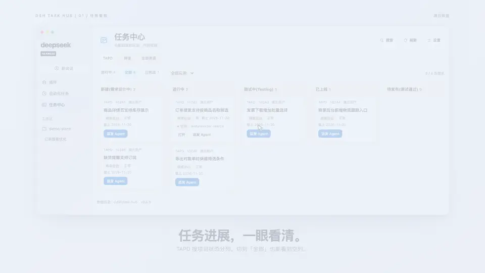

# dsh-task-hub

[English](README.en.md) · **简体中文**

DSH 的任务中心插件：从 **TAPD / 禅道** 中读取分配给你的需求或任务，选一个工作区、手填分支名，把选中的任务派发给 Agent 开始干活。

顶部可切换 TAPD、禅道和「全部来源」。禅道激活需求按研发阶段分列。选择「全部」时，TAPD 的项目状态和禅道对应范围的阶段或状态都会显示空列。右上角点「搜索」可按任务号、父需求号或标题查找。任务中心打开时每 90 秒刷新一次来源状态，也可手动刷新或按项目、应用筛选。

## 33 秒演示

[](deliverables/dsh-task-hub-apple-v3.mp4)

[播放完整视频（1080p MP4）](deliverables/dsh-task-hub-apple-v3.mp4) · 演示使用示例任务。

## 安装

```sh
dsh plugin --profile web add github:handsomeboy65/dsh-task-hub
```

装完重启 `dsh web`，侧边栏会出现「任务中心」。桌面端请在应用内的 **设置 → 插件** 里安装。

需要 DSH 0.2.1 或更新版本。包发布到 npm 之后，`dsh plugin --profile web add dsh-task-hub` 是等价写法。

## 分支名手动填写

派发弹窗要求填写**完整分支名**（例如 `feature/order-export`），插件不会再自动拼接 `issue_<需求号>`，也不会追加任何后缀。分支名会用 `git check-ref-format --branch` 校验，非法名字直接报错。

## 首次配置

点击面板右上角「设置」，先在顶部选择来源，再填写该来源的配置。

### TAPD

| 字段 | 说明 |
| --- | --- |
| 认证方式 | Token 或 API 账号 + 密码 |
| API 账号 / 密码 | TAPD 开放平台 → 个人设置 → API 账号，不是登录密码 |
| 处理人 | 过滤需求的处理人；留空表示用 TAPD 账号本身 |
| 项目 ID | TAPD 项目的 `workspace_id`，多个用逗号分隔；可点「拉取项目」选择 |
| Nick | 拉取项目列表时使用，可留空 |

### 禅道

| 字段 | 说明 |
| --- | --- |
| 禅道地址 | 例如 `https://zentao.example.com`，会自动补 `/api.php/v1` |
| 账号 / 密码 | 禅道登录账号；密码只写入 DSH credentials |
| 范围 | `产品` 读取产品需求（stories），`项目` 读取项目下各执行的任务（tasks） |
| 产品 / 项目 | 可在列表中勾选多个，也可填写多个 ID，用逗号分隔 |

禅道没有“分配给我”的接口，插件会先登录拿 token，再按当前账号在本地过滤。

凭据写入 DSH `credentials`（也可用环境变量 `TAPD_API_USER` / `TAPD_API_TOKEN` / `TAPD_API_PASSWORD` / `ZENTAO_PASSWORD` 提供），任何密钥都不会落在插件数据文件里。

### 通用

| 字段 | 说明 |
| --- | --- |
| 默认工作区 | 派发时默认选中的 DSH 工作区（如 TMS2.0） |
| 基线分支 | 留空则自动探测 `origin/HEAD` |
| 隔离 worktree | 默认开启：在仓库同级 `.dsh-worktrees/<仓库>-<分支>` 另开工作树，不打断你当前分支 |
| 默认只显示未完成任务 | 单来源默认打开「进行中」，可切到「已完成」查看历史任务 |

## 派发流程

1. 面板列出当前来源里「处理人 = 我」的条目，按最近修改排序，可筛选 未完成 / 已完成 / 全部。TAPD 需求的「应用」字段（如 `德速TMS2.0客户端`）单独占一列，排在 ID 之前；多应用时逐个标签竖排，当前来源没有应用字段时该列整列隐藏。
2. 点某条的「派发 Agent」。
3. 关联过会话的任务可以选择「继续原对话」或「新开对话」。继续时可选历史关联会话，使用它的工作区，把最新任务和附件放进草稿。输入框已有内容时会保留。新开对话时沿用需求分支。原工作区检出其他分支时，插件使用该需求分支已有的 worktree，或为该分支建立独立 worktree。首次派发时填写目标工作区、**分支名称**、worktree 和基线分支。

   「补充要求」不是拿来手写整条任务说明的：留空时插件会用需求标题、描述、附件、图片和工作约定自动生成一份任务说明；你填的内容会以 `## 补充要求` 追加在它后面，**不会替换**需求正文。
4. 首次派发确认后，插件依次执行：
   - `git worktree add -b <分支名>`（或就地 `checkout -b`）；
   - 在工作树/仓库上建立（或复用）DSH 工作区，并创建会话；
   - 把标题、来源链接、父需求及关联应用（如有）、完整需求正文、参考资料、工作环境（仓库、分支、对比基线）和执行要求写进新会话的**输入框草稿**；不再附带处理人、状态、优先级、迭代及时间等管理字段。正文不截断，描述为空时提示先读资料并澄清目标；
   - TAPD 会带上需求附件（含父/根需求）和描述截图；禅道读取需求或任务详情，并下载正文中的禅道图片和附件。这些附件同样只作为草稿附件挂在输入框上；
   - 会话标题改为 `<分支名> · <标题>`，并自动跳转到该会话。
   **不会自动发送**：跳过去之后，任务说明和附件都已经在输入框里，你看一眼、改一改，自己按发送。
5. 面板每分钟刷新分支和会话状态。宿主查询暂时失败时显示「状态暂不可用」，草稿准备中断时可重试原会话。

点「打开」可以回到最近派发的会话并恢复尚未发送的草稿。选择新开对话后，旧会话仍可在「继续原对话」中选择。

## 数据与失败模式

- 设置：`~/.dsh/task-hub/settings.json`；派发记录：`~/.dsh/task-hub/state.json`。
- 派发记录按 `来源:id`（如 `zentao:task-31`）区分，不同系统的同号条目不会互相覆盖；旧的 TAPD 记录仍按原 id 兼容。
- 就地派发默认开启智能保留本地改动。关闭后需要干净的工作区。
- 已存在同名 worktree 但停在别的分支时报冲突，不会强改。
- 一个来源读取失败时，「全部来源」仍会显示另一个来源的结果。TAPD 某个项目查询失败时会标出该项目。

## 开发

```bash
npm test     # 纯函数、git 流程、派发、客户端渲染、双来源适配
```

改完代码后，已安装的 bundle 需要重启 DSH 才会加载新的 JS 代次（安装时的首次加载可走 HMR）。

## 限制

- TAPD 只对接需求（stories），不含任务/缺陷；禅道按产品读需求或按项目读执行任务，不含缺陷。
- 不回写来源系统（不改状态、不写评论）。
- 不代替 Agent 执行计划；派发后由会话里的 Agent 自己规划与实现。
